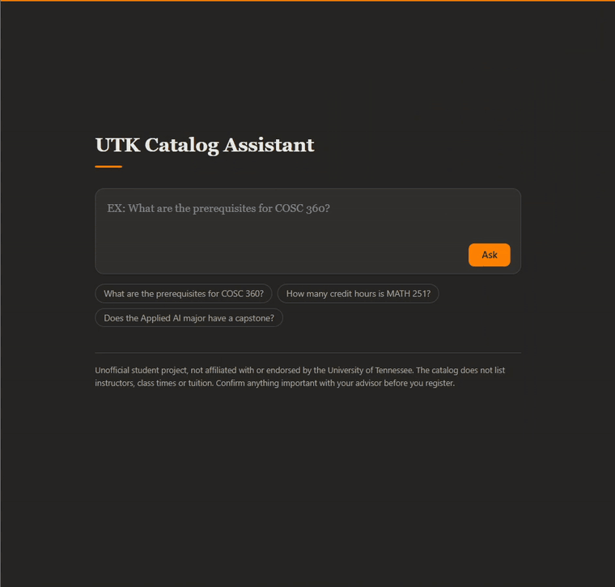
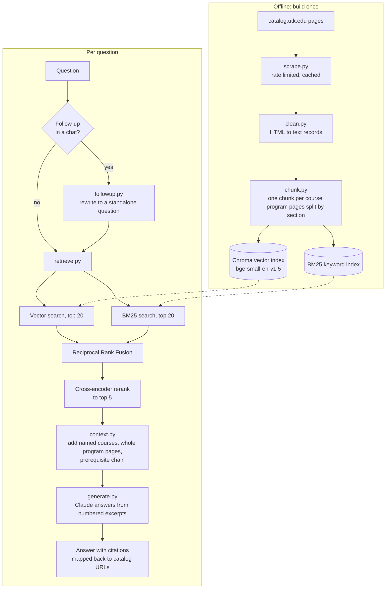

# UTK Catalog Assistant

A question-answering app for the University of Tennessee, Knoxville 2026-2027 Undergraduate Catalog, and a blind benchmark of it against UT Verse, the university's existing AI assistant.

Ask "what are the prerequisites for COSC 360?" and it searches the catalog, answers only from what it found, and links each fact to the catalog page it came from. If the catalog does not hold the answer, it says so.

> [!NOTE]
> This is an unofficial student project. It is not affiliated with or endorsed by the University of Tennessee. Confirm anything that matters with an advisor.

**Result in one line:** on 68 held-out catalog questions, this system answered 85% to 93% correctly and UT Verse 32% to 57%, depending on the grader. The gap is statistically significant under both graders. The range, and why it is a range, is explained under [Results](#results). The comparison has real limits, listed under [Limitations](#limitations); the largest is that the questions come from the part of the catalog this system was built on.



Real speed, recorded on a laptop. A sharper copy is in [docs/demo.mp4](docs/demo.mp4).

## Contents

- [What it does](#what-it-does)
- [Results](#results)
- [How it works](#how-it-works)
- [Benchmark method](#benchmark-method)
- [What was tried on the dev set](#what-was-tried-on-the-dev-set)
- [What did not work, and what I learned](#what-did-not-work-and-what-i-learned)
- [Limitations](#limitations)
- [Run it yourself](#run-it-yourself)
- [Reproduce the benchmark](#reproduce-the-benchmark)
- [Deploying a public demo](#deploying-a-public-demo)
- [Project layout](#project-layout)

## What it does

- Answers questions about courses, prerequisites, corequisites, credit hours and degree requirements.
- Cites the catalog page behind each fact. Citation links can only point at pages that were actually retrieved, so the model cannot invent a URL.
- Refuses when the catalog does not cover the question (instructors, class times, tuition, course difficulty).
- Chat page with follow-up questions: "what are its prerequisites?" works after a question about a course.
- Scope: 195 courses in COSC, MATH, ECE, AI and DATA, and 11 program pages (Applied AI, Computer Science, Data Science, Electrical Engineering and Mathematics majors, concentrations and certificates). The scraper can fetch the whole catalog; the benchmark and the committed data cover this scope only.

No LangChain or LlamaIndex. Scraping, retrieval, fusion, context building and citation handling are written directly, in about 1,900 lines of Python under `src/`.

## Results

68 test questions, never used for tuning. Each system's answer was graded with the same rubric, with the system's identity hidden. **Accuracy** means the answer contained every expected fact with nothing false, or correctly refused an unanswerable question. Partly right answers do not count.

There are two graders, and they disagree on how strict to be, so both are shown:

| | This system | UT Verse | Gap | McNemar exact p |
|---|---|---|---|---|
| **Human grades** | 92.6% (86.8 to 98.5) | 57.4% (45.6 to 69.1) | 35.3 points (22.1 to 48.5) | 0.000008 |
| **LLM judge** | 85.3% (76.5 to 92.6) | 32.4% (22.1 to 44.1) | 52.9 points (39.7 to 64.7) | 0.0000000003 |

Brackets are 95% bootstrap confidence intervals (10,000 resamples). The gap interval is from a paired bootstrap over questions.

> [!IMPORTANT]
> Quote these as a range, not the human number alone. The human column is lenient for a specific reason described in [Grading](#grading): 77 of the 136 graded responses kept an unreviewed first-pass grade of "correct". The LLM judge is stricter and independent of that problem, but has its own weaknesses. The true figure for each system most likely lies between the two columns.

### Other measures

| | This system | UT Verse |
|---|---|---|
| Hallucination rate, human | 0.0% (0 of 68) | 14.7% (10 of 68) |
| Hallucination rate, LLM judge | 2.9% (2 of 68) | 26.5% (18 of 68) |
| Partial-credit accuracy, human | 93.4% | 61.8% |
| Partial-credit accuracy, LLM judge | 89.7% | 45.6% |
| Citation accuracy (rule-based) | 98.3% (57 of 58) | 82.1% (32 of 39) |

"Hallucinated" means the answer stated a specific false fact with confidence. The judge's two hallucination calls against this system (questions cd017 and cd067) were checked against the catalog by hand and both are judge errors: the catalog does list COSC 101 as a prerequisite of COSC 103, and MATH 130 as a prerequisite of MATH 141, each with a grade of C or better. The judge's grades were left as they are; changing grades after seeing results is exactly what this benchmark is set up not to do.

Citation accuracy asks: of the answers that cited a source, how many cited a page that contains the expected answer? It is scored by rule on the 59 answerable questions. UT Verse source lists were captured for only 45 of those, so its figure rests on 39 scored answers.

### By question type

| Category | n | This system, human | UT Verse, human | This system, judge | UT Verse, judge |
|---|---|---|---|---|---|
| Single-course facts | 16 | 100% | 75% | 88% | 50% |
| Prerequisites and corequisites | 14 | 93% | 50% | 86% | 21% |
| Program requirements | 15 | 100% | 47% | 100% | 33% |
| Multi-hop (prerequisite chains) | 8 | 75% | 38% | 63% | 13% |
| Comparisons | 6 | 83% | 50% | 83% | 0% |
| Unanswerable (should refuse) | 9 | 89% | 78% | 78% | 56% |

Categories have 6 to 16 questions each, so a single question moves these figures by 6 to 17 points. They show direction, not precise values.

### Label counts

| Label | This system, human | UT Verse, human | This system, judge | UT Verse, judge |
|---|---|---|---|---|
| correct | 63 | 39 | 51 | 17 |
| partially correct | 1 | 6 | 6 | 18 |
| incorrect | 3 | 7 | 0 | 2 |
| correct refusal | 0 | 0 | 7 | 5 |
| wrong refusal | 1 | 6 | 2 | 8 |
| hallucinated | 0 | 10 | 2 | 18 |

The human grades contain no "correct refusal" label at all: on the nine unanswerable questions, responses judged right were marked "correct". Accuracy counts both labels, so the headline is unaffected, but refusal precision cannot be computed from the human grades and is not reported for them.

### Where UT Verse did better

Under the human grades, UT Verse was right and this system was not on three questions (s001, s007, s025). This system was not fully right on five in total (s001, s003, s007, s008, s025): one partial answer, three incorrect, one wrong refusal. Its weakest category under both graders is multi-hop questions, where a prerequisite chain needs several lookups.

Both systems were right on 36 questions under the human grades. UT Verse's best categories are single-course facts and refusing unanswerable questions.

### Do the two graders agree?

Over all 136 graded responses, the human and the LLM judge gave the same one-of-six label 63.2% of the time (Cohen's kappa 0.39). Reduced to "counts as right" versus "does not", they agree 82.4% of the time (kappa 0.61).

### Retrieval and cost on the test set

On the 59 answerable test questions, a correct source page was in the top 1, 3 and 5 search results for 76%, 92% and 95% of questions (MRR 0.84). An answer took about 0.4 s of search plus 3.7 s of generation and cost about 3.3 cents. The whole test run cost $3.01.

## How it works



### Design decisions

**One chunk per course; program pages split by heading.** A course entry is short (median 375 characters) and self-contained, so splitting it only loses context. Program pages are long and are split by section, with a 250-word cap. The result is 352 chunks.

**Two searches, fused.** Vector search finds paraphrases ("intro programming class") but is weak on exact course codes. BM25 keyword search is the opposite. The BM25 tokenizer treats "COSC 302", "COSC302" and "cosc 302" as the same token. The two ranked lists are merged with Reciprocal Rank Fusion: each chunk scores 1 / (60 + rank) in each list and the scores are added. RRF uses ranks only, so the two searches' incomparable scores never need to be put on one scale.

**Rerank.** A small cross-encoder reads the question and each of the top 20 fused chunks together and re-scores them. This is slower than the first-stage searches (about 0.2 to 0.4 s on a laptop CPU) but more accurate, because it sees question and passage at once.

**Context steps.** Error analysis on the dev set showed that every failure was missing context, not a wrong answer. Three steps run between search and generation: add the entry of any course code named in the question; send the whole program page (up to two) when a section of it was retrieved; follow "prerequisite" lines up to four hops to pull in the chain. See [the ablation](#context-steps).

**Generation.** The model (`claude-opus-5-5`) receives the excerpts numbered [1] to [k] and is told to answer only from them, cite the numbers, and say plainly when the answer is not there. Citation numbers in the answer are then mapped back to the chunks that were sent. Model names and settings live in `src/config.py`, the API key in `.env`.

**Chat memory in front of the pipeline, not inside it.** The page sends the last three turns with a follow-up. A small model (`claude-haiku-5-5`) rewrites the follow-up into a standalone question, and the same pipeline that was benchmarked answers it. The first question of a chat skips this step. The reply shows "Understood as: ..." whenever the question was rewritten. This was added after the benchmark and was not measured by it.

**Web app.** FastAPI with one endpoint, `POST /ask`, plus `GET /health` and a static page. Input is validated, each client is limited to 5 questions a minute and the whole server to 200 a day (both configurable), error messages sent to the browser are fixed strings, and the page renders model output as text only, never as HTML.

## Benchmark method

The goal was a comparison that would survive questioning, including results that do not flatter this system. The rules were set before any results existed.

### Questions

112 questions, each with a short expected answer, the catalog page or pages that contain it, a category and an origin. Expected answers were drafted from the scraped catalog text and checked by hand.

| | Dev | Test |
|---|---|---|
| Questions | 44 | 68 |
| Derived from catalog pages | 22 | 50 |
| Written by me | 16 | 17 |
| Typo and slang phrasings | 6 | 1 |

The split is random and stratified by category (seed 20261106). 15 of the 112 questions are deliberately unanswerable from the catalog.

### Separation of dev and test

- The question set was written and locked **before** any retrieval code existed. The SHA-256 of the test file is in `benchmark/test_set.sha256` and is checked by the eval script.
- All tuning used the dev set only.
- Before the test set was run, every setting that can change an answer was frozen in `benchmark/frozen_config.json`: chunking, retrieval, context steps, models, and hashes of the system prompt, the chunk file and the grading rubric. `run_eval --split test` refuses to run if the test hash or any frozen setting has changed.
- The test set was run **once**, on 2026-11-13.
- The grading rubric (`benchmark/GRADING_RUBRIC.md`) and the metric definitions were written before any answers existed.

`python -m benchmark.lock --verify` and `python -m benchmark.freeze --verify` still pass on this repository. The git history shows the order of these steps.

### Collecting UT Verse answers

UT Verse (utverse.tennessee.edu) is the university's general AI assistant, used here in its default assistant with web search and Deep Research turned on. Its terms of use (UT policy IT0002) were read first. Every question was asked exactly as written through the normal chat page, in the signed-in student account. Dev answers were collected from 2026-11-06 to 2026-11-13 and test answers on 2026-11-13.

Honest notes on collection:

- 45 of the 68 test answers were collected with a browser assistant that typed each question into a new chat and copied the reply with the site's own copy button, one at a time. The other 23 were pasted in by hand, and for those it was not recorded whether each used a new chat and the same search settings. The same is true of 12 of the 44 dev answers.
- One test question (cd026) was asked twice because the first copy failed; the first answer was never saved or read. One answer (s014) was re-entered by hand after the first save captured the question text instead.
- Raw UT Verse responses are not in this repository. The cleaned text that was graded is in `benchmark/grading/blind_sheet.csv`.

### Grading

`make_blind_sheet.py` puts both systems' answers for each question in random order as "Response A" and "Response B", and strips what gives a system away: citation markers, source lists, interface text. The key that says which is which was hashed and committed before grading and only opened afterwards.

Two graders used the same rubric with six labels (correct, partially correct, incorrect, correct refusal, wrong refusal, hallucinated):

1. **Human**, with a small command-line tool (`benchmark/grade.py`).
2. **LLM judge** (`claude-sonnet-5-5`). The rubric is sent to it word for word. It is not told the question's category or which system wrote the response.

**What went wrong with the human grading, stated plainly.** My first pass over all 136 responses was far too fast to be real grading: 134 were marked "correct" in under five minutes. Those grades were not scored. I then had an AI model review the blind sheet and flag responses that looked wrong; it flagged 59, and I regraded those 59 properly. The other 77 kept their first-pass "correct". Consequences:

- The human column is lenient. The LLM judge disagrees with 11 of those 77 unreviewed grades.
- Blinding was weakened for the regraded items, because the review described which style of answer contained the errors.
- The first-pass file is kept in the repository (`benchmark/grading/human_grades.first_pass.csv.bak`) so this is checkable.

The original plan was to make the human grades the headline. Given the above, both graders are reported side by side and neither is treated as the headline. The scoring code was written and committed before the key was opened.

### Statistics

- 95% confidence intervals: percentile bootstrap, 10,000 resamples, fixed seed.
- Gap between systems: paired bootstrap, resampling questions.
- Significance: McNemar's exact test on the questions where exactly one system was right (27 versus 3 under human grades, 37 versus 1 under the judge).
- Grader agreement: raw agreement and Cohen's kappa.

## What was tried on the dev set

Everything in this section was measured on the 44 dev questions, graded by the LLM judge. With 44 questions, one question is 2.3 points, and two runs of the same setup differed by one grade because the model's answers are not deterministic. Differences of one or two questions are noise. The full log is in `benchmark/TUNING_LOG.md`.

### Retrieval mode and chunking

Share of the 38 answerable dev questions where a correct source page was in the top 5 results:

| Chunking | Vector | BM25 | Hybrid (RRF) | Hybrid + rerank |
|---|---|---|---|---|
| By section, 250 words (chosen) | 0.92 | 0.76 | 0.87 | 0.95 |
| By section, 150 words | 0.92 | 0.76 | 0.92 | 0.95 |
| Packed sections, 250 words | 0.89 | 0.87 | 0.84 | 0.92 |
| Packed sections, 350 words | 0.84 | 0.84 | 0.95 | 0.89 |

Hybrid + rerank had the best MRR in every chunking. Chunking differences are within noise, so the simplest setting was kept.

### Answer accuracy by retrieval mode (before context steps)

| Mode | Accuracy | Hallucinated | Wrong refusals | Search time |
|---|---|---|---|---|
| Vector | 0.64 | 0 | 7 | 10 ms |
| BM25 | 0.48 | 0 | 13 | under 1 ms |
| Hybrid (RRF) | 0.59 | 1 | 7 | 12 ms |
| Hybrid + rerank | 0.70 | 0 | 4 | 222 ms |

### Context steps

All 13 failures of hybrid + rerank were missing context: the model correctly said the excerpts did not hold the answer. Six of them needed facts spread over many sections of one program page.

| Context steps | Accuracy | Hallucinated | Excerpts sent | Cost per answer |
|---|---|---|---|---|
| None | 0.70 (31 of 44) | 0 | 5 | $0.015 |
| Named courses | 0.73 (32) | 0 | 5.0 | $0.015 |
| Prerequisite chain | 0.73 (32) | 0 | 7.3 | $0.018 |
| Whole program pages | 0.80 (35) | 0 | 17.7 | $0.034 |
| All three (chosen) | 0.84 (37) | 0 | 20.0 | $0.037 |

Sending whole program pages gives most of the gain and most of the cost.

**Overfitting check.** These steps were designed after reading the same dev failures they fix, so 0.84 on dev was expected to be optimistic. On the test set the same judge gave 0.85, so the gain held on questions the steps were never tuned on.

## What did not work, and what I learned

- **Plain hybrid search was worse than vector search alone.** On the default chunking, RRF fusion scored below vector search for both retrieval (hit@5 0.87 versus 0.92) and answers (0.59 versus 0.64). BM25 is weak on casually worded questions and drags the fusion down. Hybrid only paid off once the cross-encoder re-scored the fused list. "Hybrid is better" is not automatic.
- **The retrieval metric overstated retrieval.** hit@k counts a hit when any chunk of the right page is found, even the wrong section. One dev question had the right page at rank 2 and still got an incomplete answer. This is what pointed to sending whole program pages.
- **Chunk size barely mattered** for this data, within the noise of 44 questions. Larger packed chunks ran into the embedding model's 512-token limit.
- **The failures were retrieval failures, not model failures.** Before context steps, the model produced zero hallucinations on dev with hybrid + rerank; it refused when it lacked the text. Improving what was sent to the model moved accuracy by 14 points. No prompt changes were needed.
- **Fixes I did not make.** "CS" does not match the Computer Science program page, and an abbreviation map would fix one dev question. One question is thin evidence, so it was left out. A four-link prerequisite chain still fails because the cap on followed courses is used up by branches.
- **A known rough edge.** For a course with no catalog entry, the model can end with advice to "check the COSC 302 entry in the full catalog", which implies an entry exists.
- **An LLM judge is not ground truth.** It has no access to the catalog page, so it cannot check extra facts in an answer, and it made two verifiable errors against this system. It is useful as a second, consistent grader, not as a replacement for careful human grading.
- **Careful human grading is the expensive part,** and I underestimated it. The grading section above is the cost of that. Next time I would grade a smaller sample properly rather than a larger one quickly.
- **Once, in the live app, the model returned a garbled answer** with no citations. The same question then answered correctly, and none of the saved benchmark answers show the problem. The cause is not known and no guard was added.

## Limitations

**The comparison is narrower than "better than UT Verse".**

- **Scope favours this system.** Every question comes from the 2026-2027 catalog pages for five departments, which is exactly the data this system was built on. UT Verse is a general campus assistant that searches the web. It often cited catalog pages from earlier years and sometimes reported that a catalog page could not be loaded. This benchmark measures one narrow task. It says nothing about the many other things UT Verse is for.
- **Small sample.** 68 test questions. The confidence intervals are wide, and per-category figures rest on 6 to 16 questions.
- **Human grades are partly unreviewed** (see [Grading](#grading)), and blinding was weakened for the regraded part.
- **The LLM judge shares a model family with this system's generator.** Both are Claude models. The judge also cannot see catalog pages.
- **One snapshot in time.** UT Verse answers were collected in November 2026. It may have changed since.
- **Collection settings were not verified for every UT Verse answer** (23 test and 12 dev answers), and its source lists are missing for 14 of the 59 answerable test questions.
- **Test set composition.** Only one typo-and-slang question landed in the test split. No questions came from classmates, so phrasing reflects one person plus the catalog. Two pairs of near-duplicate questions are split across dev and test.
- **The test run is recorded with uncommitted files in the working tree** (grading files only; the frozen config and test hash matched).

**The system itself.**

- Covers five course prefixes and eleven program pages, not the whole catalog.
- The catalog site blocks automated access to program pages, so six program pages come from Internet Archive snapshots and five were saved by hand from a browser. Course pages were fetched live at one request every 120 seconds, as the site's robots.txt asks.
- Follow-up question handling was added after the benchmark and is not measured. The rewriter sometimes rewords a question that already stood on its own.
- Chat memory is three turns, kept in the browser. Reloading the page clears it.
- Each answer costs about 3 to 4 cents in API fees.
- The rate limiter is in memory: it resets on restart and is not shared between server processes.

## Run it yourself

Requires Python 3.11 or newer and an Anthropic API key. Developed on Windows with Python 3.11.9; installing from a fresh clone on another machine has not been tested.

```bash
git clone https://github.com/Ethan-Diperna/UTK-VOLBOT.git
```

```bash
cd UTK-VOLBOT
```

```bash
pip install -r requirements.txt
```

Create a file named `.env` in the project folder, using `.env.example` as the template, and put your key on the `ANTHROPIC_API_KEY` line. If you already have a `.env`, edit it rather than copying over it. The file is ignored by git.

Build the search indexes. The cleaned catalog text is already in `data/processed/`, so no scraping is needed. The first run downloads the embedding and reranker models from Hugging Face.

```bash
python -m src.index
```

Start the app, then open http://localhost:8000.

```bash
python -m uvicorn app.main:app --port 8000
```

Other entry points:

```bash
python -m src.retrieve "prereqs for cosc 360" --mode all
```

```bash
python -m src.generate "what are the prereqs for cosc 360" --show-chunks
```

```bash
python -m pytest -q
```

The first command shows ranked chunks from every search mode and makes no API call. The second answers one question from the terminal and does cost money. The test suite (230 tests) uses fake model clients and makes no API calls.

Settings that can be overridden in `.env`: `GENERATION_MODEL`, `JUDGE_MODEL`, `REWRITE_MODEL`, `GENERATION_EFFORT`, `API_RATE_LIMIT_PER_CLIENT`, `API_DAILY_REQUEST_CAP`. Everything else is in `src/config.py`.

To re-scrape, see `python -m src.scrape --help`. A full scrape of the default scope takes several hours because of the 120-second delay.

## Reproduce the benchmark

Check that nothing was changed after the fact:

```bash
python -m benchmark.lock --verify
```

```bash
python -m benchmark.freeze --verify
```

Re-score the head-to-head from the committed grades (no API calls; it prints the report and writes a new timestamped folder under `benchmark/results/`):

```bash
python -m benchmark.score
```

Run the dev evaluation (retrieval only is free; `--answers` calls the API):

```bash
python -m benchmark.run_eval --split dev
```

```bash
python -m benchmark.run_eval --split dev --answers
```

The saved runs are under `benchmark/results/`: ten dev runs, the single test run (`20261113T165341Z_test`), and the head-to-head scores (`20261113T210558Z_headtohead/score.json`). The numbers in this README are read from those files. Because model output is not deterministic, a fresh run will differ by a question or so.

## Deploying a public demo

Not deployed yet. The repository has a `Dockerfile` that any host able to build a Docker image can use. It installs the CPU build of PyTorch, builds the search indexes, downloads both search models into the image, and starts the app on the port the host gives it (`PORT`, default 7860).

```bash
docker build -t catalog-assistant .
```

```bash
docker run -p 7860:7860 -e ANTHROPIC_API_KEY=your-key catalog-assistant
```

What has and has not been checked (2026-11-13): the image's start command, its handling of the visitor address behind a proxy, and loading the models with no network were each tested outside Docker. The image itself has not been built, because Docker was not available on the development machine. Expect to fix small things on the first real build.

Choosing a host:

- **Memory.** The running app measured about 820 MB with both search models loaded. Hosts that give 512 MB are too small, which rules out Render's free plan (512 MB, per its documentation on 2026-11-13). Pick a plan with 1 GB or more.
- **Hugging Face Spaces** gives 16 GB on its basic CPU hardware, but its documentation (read 2026-11-13) says creating a Docker Space requires a paid plan. The `Dockerfile` follows its rules (user id 1000, port 7860). A Space also needs a short settings block at the top of its own README with `sdk: docker`.
- Set `ANTHROPIC_API_KEY` as a host secret, never in the repository or the image.
- Lower `API_DAILY_REQUEST_CAP`. At about 4 cents per answer, the default of 200 a day allows up to about $8 a day.
- Behind a host's proxy, every visitor appears to come from the proxy's address. The image starts uvicorn with `--proxy-headers` so the per-client limit sees the real address. A visitor can fake that header to dodge the per-client limit, so the daily cap is the real protection for the API bill.

## Project layout

```
src/
  scrape.py         fetch catalog pages (rate limited, cached, resumable)
  wayback.py        Internet Archive fallback for pages the site blocks
  catalog_links.py  URL patterns of the catalog site
  clean.py          HTML to {id, url, title, doc_type, dept, text, metadata}
  chunk.py          courses whole, program pages by section
  index.py          build the Chroma and BM25 indexes
  retrieve.py       vector, BM25, RRF hybrid, cross-encoder rerank
  context.py        named courses, whole program pages, prerequisite chain
  generate.py       prompt, Claude call, citation mapping, error handling
  followup.py       rewrite a chat follow-up into a standalone question
  config.py         every setting and model name
app/
  main.py           FastAPI: /ask, /health, rate limit, security headers
  static/           the chat page (plain HTML, CSS, JavaScript)
benchmark/
  questions_dev.jsonl, questions_test.jsonl   the question sets
  test_set.sha256, frozen_config.json         the locks
  GRADING_RUBRIC.md                           labels and metrics, fixed in advance
  TUNING_LOG.md                               everything tried on dev
  run_eval.py       retrieval and answer evaluation
  judge.py          the LLM judge
  make_blind_sheet.py, grade.py, judge_sheet.py   blind grading
  stats.py, score.py                          bootstrap, McNemar, kappa, report
  grading/          blind sheet, key, human and judge grades
  results/          saved runs
tests/              230 tests, model calls faked
Dockerfile          container image for hosting the app
data/processed/     cleaned catalog text and chunks
```

## A note on UT Verse

UT Verse is a general-purpose assistant for a whole university, and this project tests it on one narrow task it was not specifically built for, using questions drawn from this project's own data. A specialised tool doing better on its own specialty is the expected result, not a criticism of the general one. The useful finding is narrower: for catalog questions, answering only from the current year's catalog text, with citations and a willingness to say "the catalog does not say", gives fewer confident wrong answers than searching the open web.
